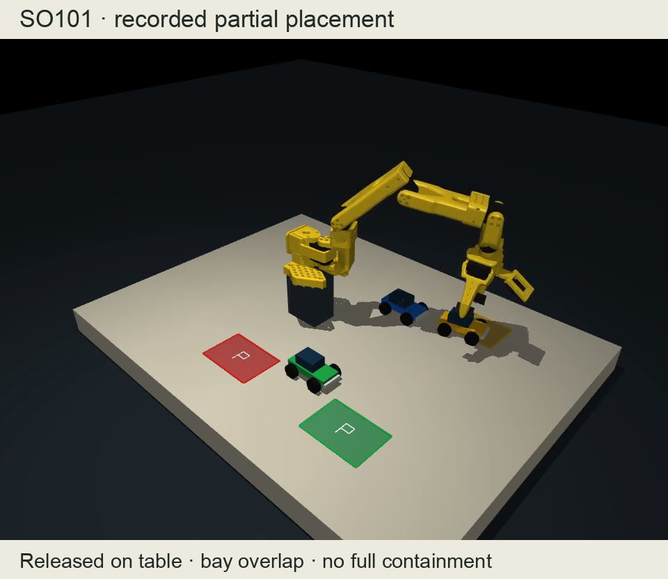
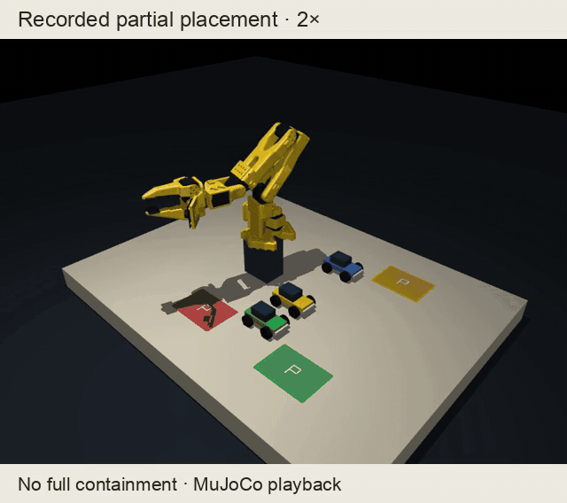

# SO-101 car parking

Language-guided toy-car placement in MuJoCo with a fine-tuned pi0.5 policy.
The selected checkpoint demonstrates partial bay overlap. Full parking remains unreliable.





[Watch the 15-second preview](docs/media/demo.mp4) or the [full project video](https://huggingface.co/blazeofchi/so101-car-parking-pi05/resolve/main/media/submission.mp4). The clip shows a partial placement, not full containment.

## Setup

Use Python 3.12 and a CUDA GPU for training or policy inference.
Accept the PaliGemma license before downloading its tokenizer.

```sh
python -m pip install -e .
so101-preview --seed 42
```

## Layout

```text
src/so101_car_parking/
  simulation/   scenes, robot assets and scripted teacher
  data/         demonstration collection and export
  policy/       model loading and training
  evaluation/   policy rollouts, scoring and playback
```

## Data and training

```sh
so101-collect --count 100 --output data/base --workers 3
so101-export data/base
so101-collect-more --count 200 --output data/extra --workers 3
so101-export data/extra
so101-merge data/base data/extra data/parking-300
so101-prepare data/parking-300/lerobot
so101-train --data data/parking-300/lerobot --output runs/pi05 --steps 6000 --batch-size 32 --save-every 1000
```

## Evaluation and video

Download the selected checkpoint. Its weights use the Gemma license.

```sh
hf download blazeofchi/so101-car-parking-pi05 --local-dir checkpoints/003000/policy
hf download blazeofchi/so101-car-parking-validation --repo-type dataset --include "raw/*.json" --local-dir data/evaluation
```

[Model](https://huggingface.co/blazeofchi/so101-car-parking-pi05) · [Training data](https://huggingface.co/datasets/blazeofchi/so101-car-parking-train) · [Validation data](https://huggingface.co/datasets/blazeofchi/so101-car-parking-validation)

```sh
so101-evaluate checkpoints/003000/policy --collection data/evaluation --output runs/eval --eager
so101-replay runs/eval/scene_00.json --video captures/example.mp4
```

The robot asset license is retained under `src/so101_car_parking/simulation/assets/models/so101/LICENSE`.
